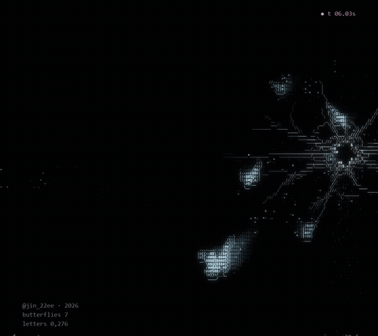
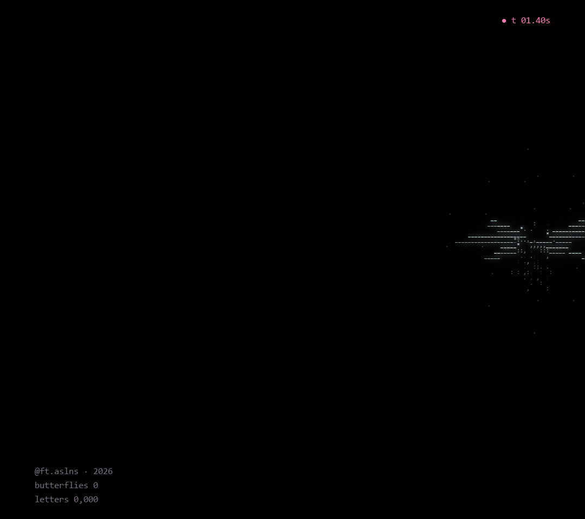
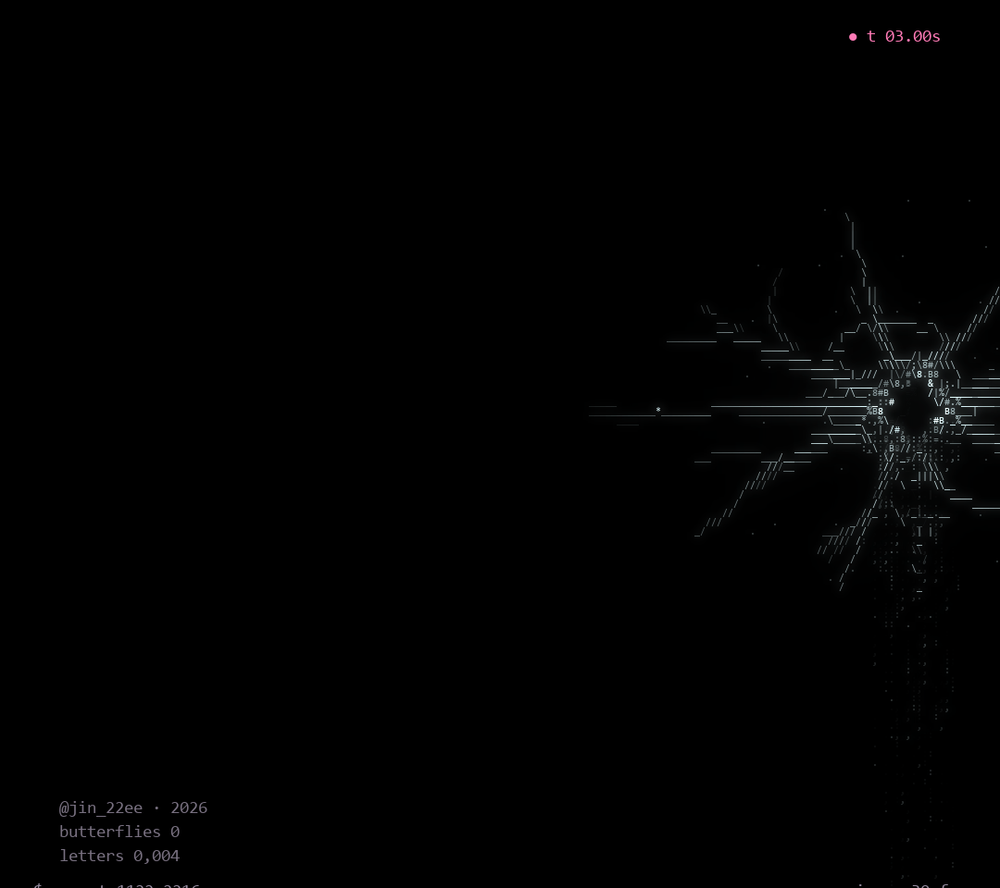
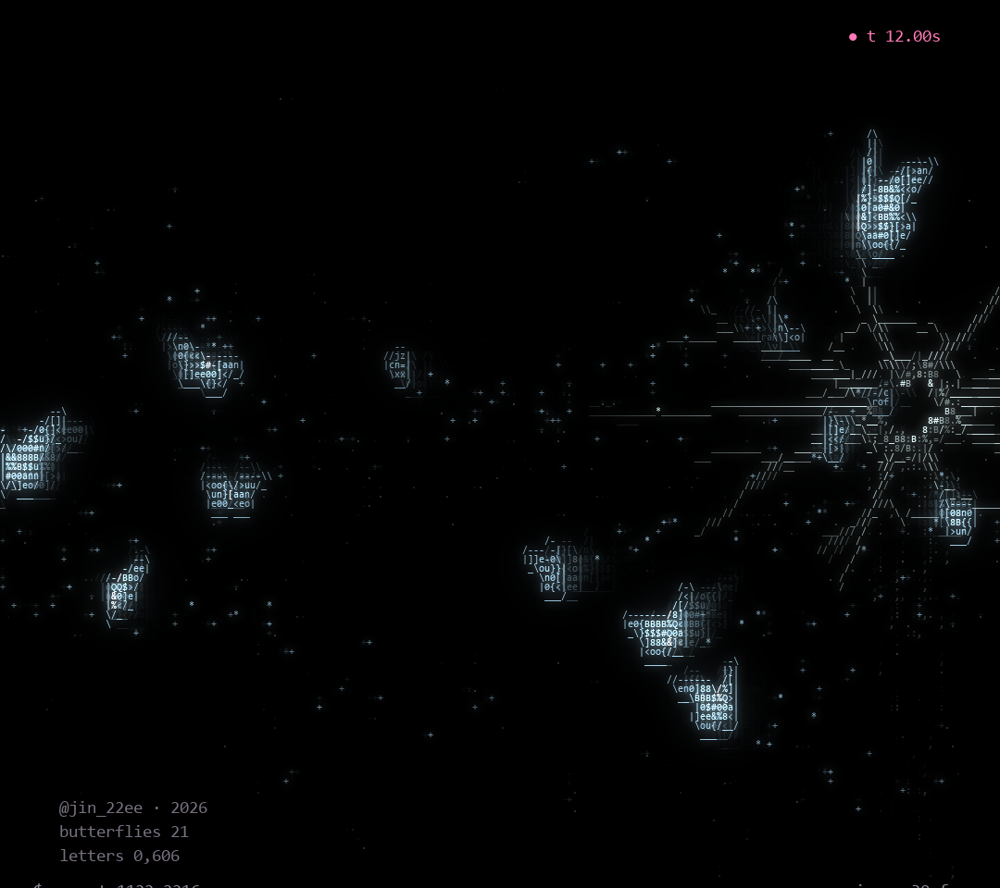

# BUTTERFLY

**[Play on your phone — no installation](https://amsoulness.github.io/aslns-ascii-art/?art=BUTTERFLY)**

Butterfly · ASCII Code Art · ASLNS, 2026



## Artist's Note

Something knocks on the wall from the other side.
A hairline crack, then another hit, and another, until the glass gives way.
Butterflies slip out of the hole one by one and wander off, near and far, in and out of view.

| crack | break | flight |
|---|---|---|
|  |  |  |

## Technology

Python · NumPy · pygame-ce

## Creative Process

1. Wings: a forewing and a hindwing drawn as outlines, filled with points, brighter toward the body.
2. Flight: each wing beats on its own rhythm, the body dips on the downstroke and leans into turns.
3. Paths: twenty-two butterflies, each with its own home, depth and slow wandering loop that can leave the frame and come back.
4. Glass: the cracks only move when the wall is hit. Radial cracks fork as they run, round cracks join them, and on the last hit the center pieces drop out.
5. Dust: puffs on every hit, powder falling off the broken edge, and glitter shaken from the wings.

## Technical Concepts

Point-in-polygon sampling · perspective projection with depth ordering · random-walk crack paths
Impact timing with ease-out · per-cell hashing for texture · trail and glow pass

## Source Code

The full Python source is included in this folder.

```
pip install -r requirements.txt
python butterfly.py
```

Space pause, R restart, S screenshot, Esc quit.
Rules for using this code:
I share this code for you. Study it, change it, and use what you learn to make your own ASCII art.
- Don't repost this code, or a big part of it, as your own.
- Don't post my artwork (videos or images) as your own.
- Don't sell it, or use it commercially without my permission.
- Don't use it to train AI models.

A credit to @ft.aslns is always appreciated. If you see my code or artwork posted as someone else's, please report it and let me know on Instagram [@ft.aslns](https://instagram.com/ft.aslns).

Full terms: [LICENSE.txt](LICENSE.txt)

---

Artist: ASLNS · Instagram [@ft.aslns](https://instagram.com/ft.aslns)
© 2026 ASLNS. All rights reserved. Images and video in this repository may not be reused without permission.

## Setup and controls

Tested on Windows with Python 3.12. From this artwork folder:

```sh
python -m pip install -r requirements.txt
python butterfly.py
```

Click the artwork window to use **Space** to pause/resume, **R** to restart,
**S** to save a PNG beside `butterfly.py`, and **Esc** to close.
The animation repeats automatically and the window scales to the available display.

Keep the complete artwork folder together when moving it. The interactive application uses worker processes to compute frames ahead.

## Preview capture

The three screenshots and `images/preview.gif` were regenerated by running this artwork's
window renderer on 26 November 2026. Screenshots retain the full 1080 × 960 canvas,
including attribution and status text. The looping GIF is 432 × 384 at 5 fps;
it samples the complete animation rather than recording real-time desktop performance.
The capture runner evaluates 10 animation timestamps per second with an offscreen display.

From the repository root, install `requirements-preview.txt`, then run:

```sh
python tools/capture_previews.py BUTTERFLY
```

See [capture details](../PREVIEWS.md) and [capture timestamps](../PREVIEW_CAPTURE.json).
