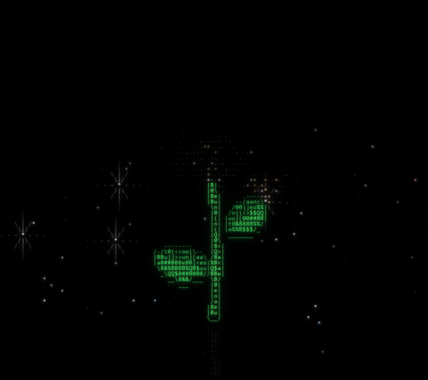

# DAISY

Daisy · ASCII Code Art · ASLNS, 2026


## About

A stem grows from drifting sparks, then twenty-four white petals open around a golden center.
The flower sways gently as dewdrops catch the light and fall to the ground.
Adapted from ASLNS's flower animation with a radial daisy shape and a golden-angle seed disk.

| growing | opening | bloom |
|---|---|---|
|  |  |  |

## Technology

Python · NumPy · pygame-ce

## Creative Process

1. Plant: a curved stem, two leaves, and five green sepals sampled in 3D.
2. Petals: twenty-four narrow white surfaces spread radially, opening in staggered groups.
3. Center: golden-angle points form a domed yellow disk with a seed-like texture.
4. Motion: soft sway, trailing petal tips, glitter, dewdrops, and a floor reflection.
5. Rendering: points become letters and symbols with light, outlines, trails, and glow.

## Run

```sh
pip install -r requirements.txt
python daisy.py
```

Space pause, R restart, S screenshot, Esc quit.
Screenshots are saved beside daisy.py as daisy_<timestamp>.png.

## License and credit

Original renderer and artwork framework by ASLNS · [@ft.aslns](https://instagram.com/ft.aslns).
This daisy variation retains the original attribution and license.
For personal use and learning; see [LICENSE.txt](LICENSE.txt) for the full terms.
Do not repost the code or artwork as your own, sell it or use it commercially without permission,
or use it to train AI models.

© 2026 ASLNS. All rights reserved.
