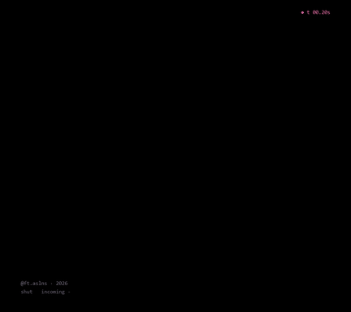
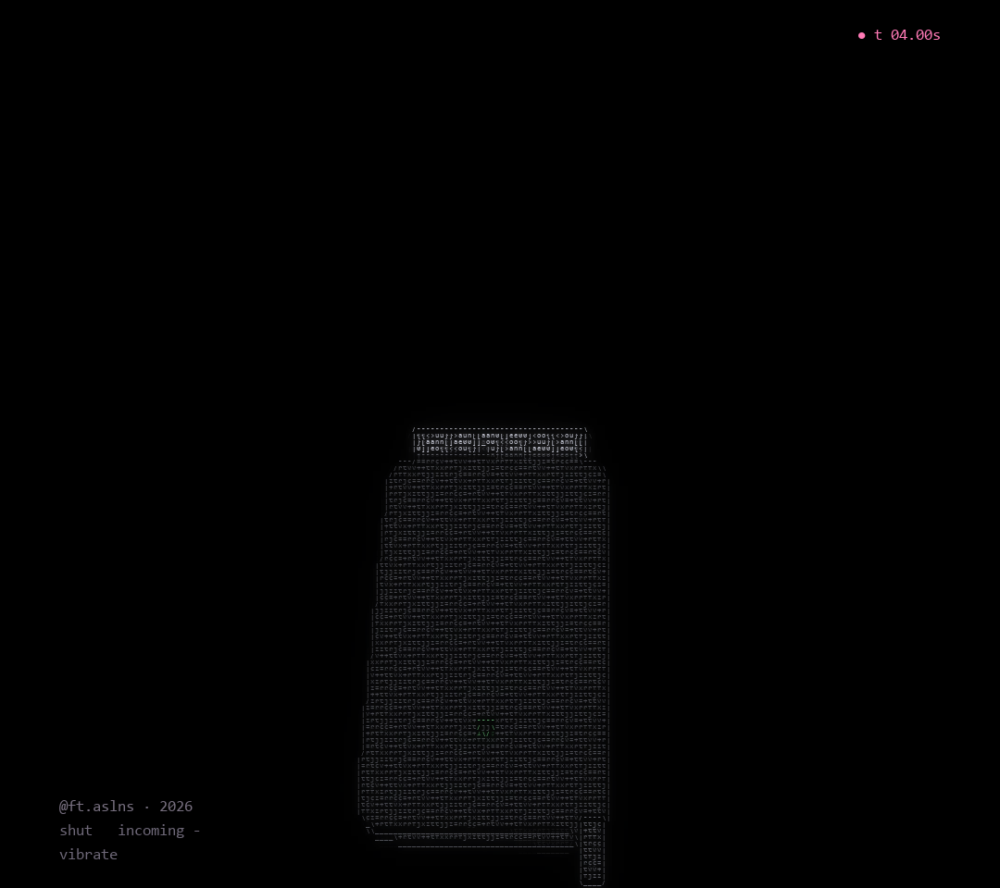
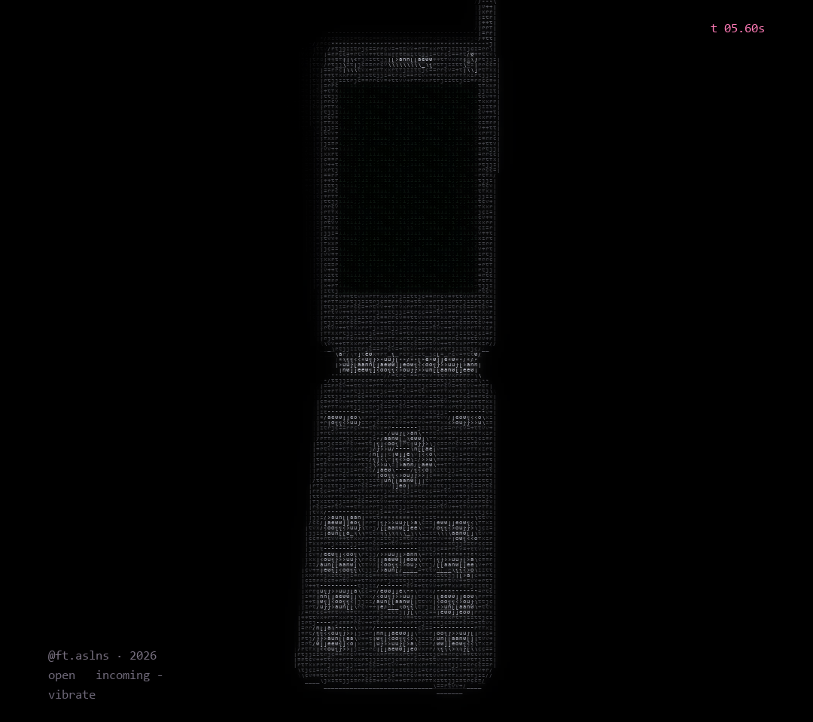
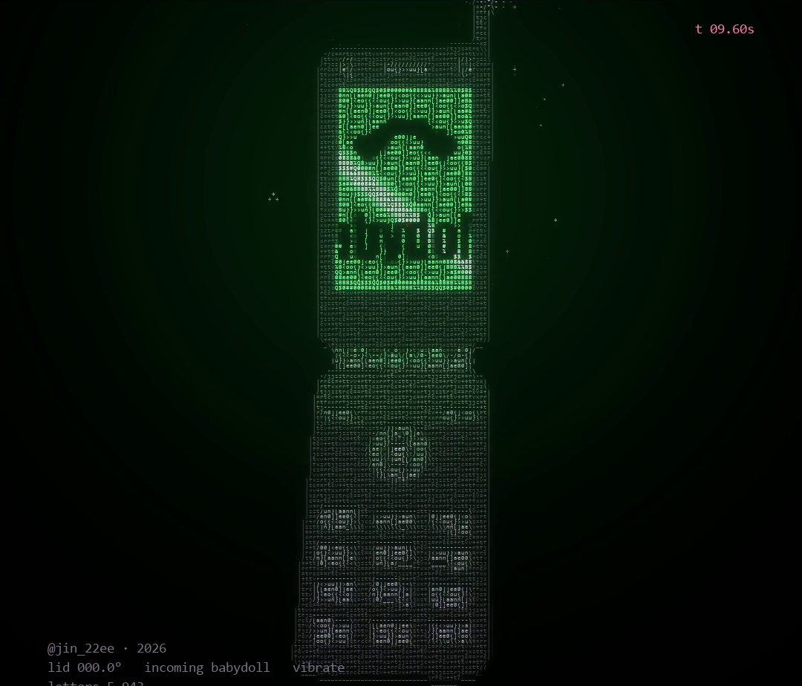

# FLIP PHONE

**[Play on your phone — no installation](https://amsoulness.github.io/aslns-ascii-art/?art=FLIP-PHONE)**

Incoming Call · ASCII Code Art · ASLNS, 2026



## Artist's Note

An old flip phone, shut, buzzing on the table. It opens, the little screen lights up green, and "babydoll" is calling.

| shut | opening | calling |
|---|---|---|
|  |  |  |

## Technology

Python · NumPy · pygame-ce

## Creative Process

1. Phone: two halves joined at a hinge. The keypad half has twelve keys, two soft keys and a round d-pad; the screen half has the screen, a speaker and a short antenna.
2. Ring: it buzzes for 1.2 seconds and rests for 0.8, shaking a little while it is still shut.
3. Opening: the screen half swings up around the hinge, goes a little past and settles back.
4. Screen: it flickers on, turns green, and the handset and the scrolling name are cut out of the green, cell by cell.
5. Light: a band of light drifts across the glass, green light spills onto the keys near the hinge and glows around the screen, swelling with every buzz.

## Technical Concepts

Points on surfaces projected into a letter grid · outlines where one part ends · rotation about a hinge with an overshoot
Texture mapped onto the screen with a homography · light falloff by distance · trail and glow pass

## Source Code

The full Python source is free and included in this folder.

```
pip install -r requirements.txt
python flip_phone.py
```

Space pause, R restart, S screenshot, Esc quit.
Rules for using this code:
I share this code for you. Study it, change it, and use what you learn to make your own ASCII art.
- Don't repost this code, or a big part of it, as your own.
- Don't post my artwork (videos or images) as your own.
- Don't sell it, or use it commercially without my permission.
- Don't use it to train AI models.

A credit to @ft.aslns is always appreciated. If you see my code or artwork posted as someone else's, please report it and let me know on Instagram [@ft.aslns](https://instagram.com/ft.aslns).

Full terms: [LICENSE.txt](LICENSE.txt)

---

Artist: ASLNS · Instagram [@ft.aslns](https://instagram.com/ft.aslns)
© 2026 ASLNS. All rights reserved. Images and video in this repository may not be reused without permission.

## Setup and controls

Tested on Windows with Python 3.12. From this artwork folder:

```sh
python -m pip install -r requirements.txt
python flip_phone.py
```

Click the artwork window to use **Space** to pause/resume, **R** to restart,
**S** to save a PNG beside `flip_phone.py`, and **Esc** to close.
The animation repeats automatically and the window scales to the available display.

Keep the complete artwork folder together when moving it.

## Preview capture

The three screenshots and `images/preview.gif` were regenerated by running this artwork's
window renderer on 26 November 2026. Screenshots retain the full 1080 × 960 canvas,
including attribution and status text. The looping GIF is 432 × 384 at 5 fps;
it samples the complete animation rather than recording real-time desktop performance.
The capture runner evaluates 10 animation timestamps per second with an offscreen display.

From the repository root, install `requirements-preview.txt`, then run:

```sh
python tools/capture_previews.py FLIP-PHONE
```

See [capture details](../PREVIEWS.md) and [capture timestamps](../PREVIEW_CAPTURE.json).
