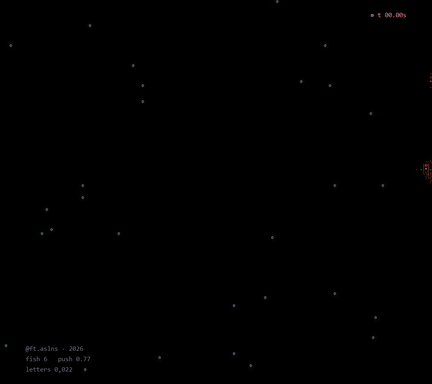
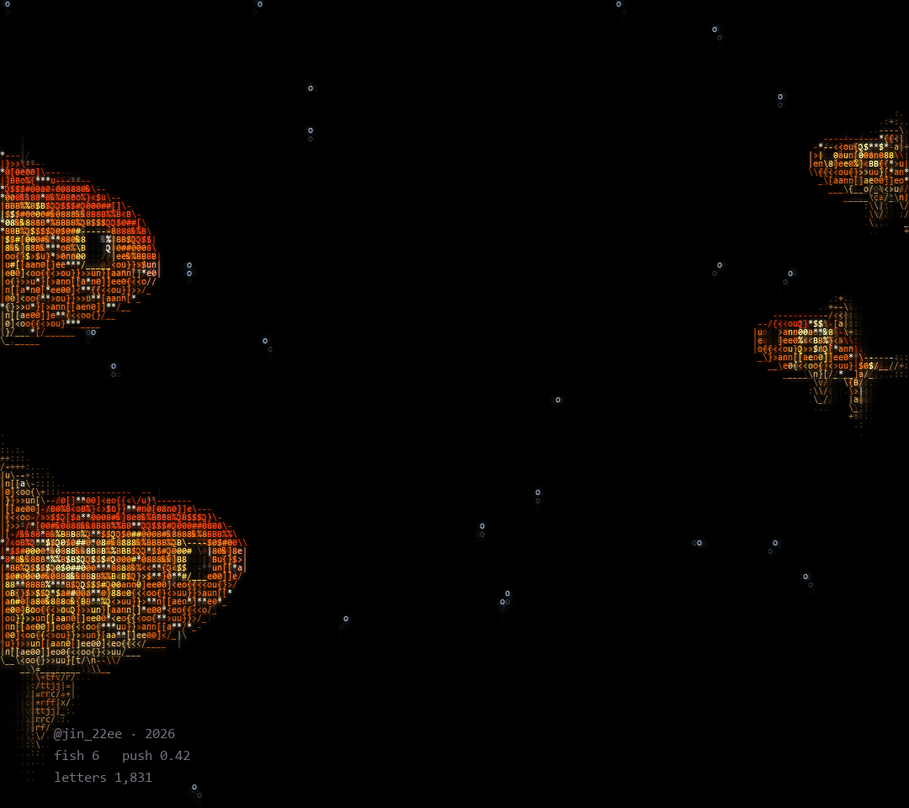
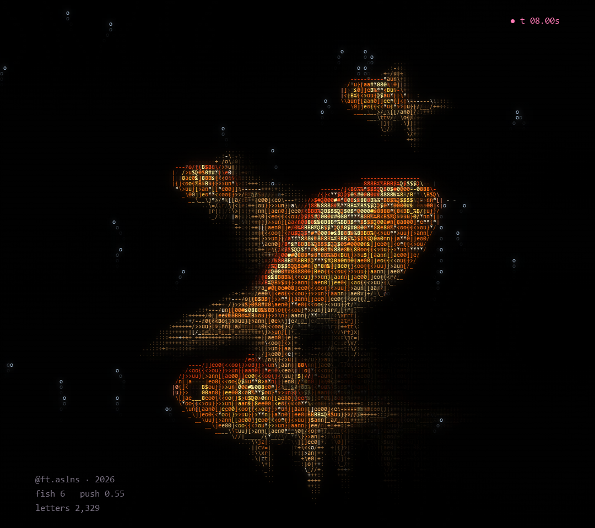
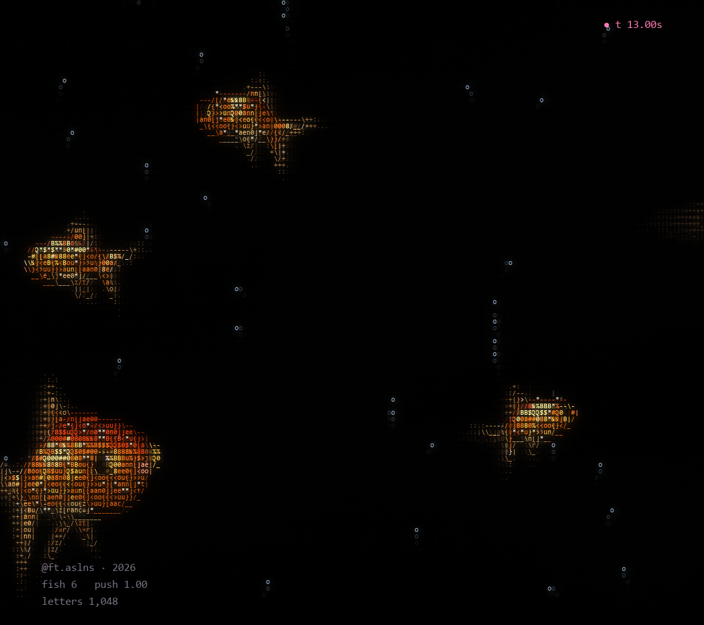

# GOLDFISH

**[Play on your phone — no installation](https://amsoulness.github.io/aslns-ascii-art/?art=GOLDFISH)**

Goldfish · ASCII Code Art · ASLNS, 2026



## Artist's Note

Six goldfish swim through dark water.
Some glide, some dart and pause, the small ones drift far behind.
One of them stops for a moment to look at you, then swims on.

| swim | hello | together |
|---|---|---|
|  |  |  |

## Technology

Python · NumPy · pygame-ce

## Creative Process

1. Shape: the side outline of a goldfish, swept round into a real 3D body with a raised gill cover, bulging eyes and a mouth that opens and closes.
2. Skin: offset rows of scales, red on the back, gold on the flank, pale on the belly.
3. Fins: two-lobed tail and soft fins with rays, solid near the body and thinning out to nothing at the edge.
4. Light: from the upper left; the side facing it is brighter, scale edges catch highlights and a scale flashes now and then.
5. Motion: six paths, near and far, each with its own pace, turns and pauses, and bubbles rising.

## Technical Concepts

Surface of revolution from a 2D outline · surface normals and specular light · keyframed paths with smooth curves
Heading from velocity · perspective projection with depth ordering · outline detection between parts · trail and glow pass

## Source Code

The full Python source is included in this folder.

```
pip install -r requirements.txt
python goldfish.py
```

Space pause, R restart, S screenshot, Esc quit.
Rules for using this code:
I share this code for you. Study it, change it, and use what you learn to make your own ASCII art.
- Don't repost this code, or a big part of it, as your own.
- Don't post my artwork (videos or images) as your own.
- Don't sell it, or use it commercially without my permission.
- Don't use it to train AI models.

A credit to @ft.aslns is always appreciated. If you see my code or artwork posted as someone else's, please report it and let me know on Instagram [@ft.aslns](https://instagram.com/ft.aslns).

Full terms: [LICENSE.txt](LICENSE.txt)

---

Artist: ASLNS · Instagram [@ft.aslns](https://instagram.com/ft.aslns)
© 2026 ASLNS. All rights reserved. Images and video in this repository may not be reused without permission.

## Setup and controls

Tested on Windows with Python 3.12. From this artwork folder:

```sh
python -m pip install -r requirements.txt
python goldfish.py
```

Click the artwork window to use **Space** to pause/resume, **R** to restart,
**S** to save a PNG beside `goldfish.py`, and **Esc** to close.
The animation repeats automatically and the window scales to the available display.

Keep the complete artwork folder together when moving it. The interactive application uses worker processes to compute frames ahead.

## Preview capture

The three screenshots and `images/preview.gif` were regenerated by running this artwork's
window renderer on 26 November 2026. Screenshots retain the full 1080 × 960 canvas,
including attribution and status text. The looping GIF is 432 × 384 at 5 fps;
it samples the complete animation rather than recording real-time desktop performance.
The capture runner evaluates 10 animation timestamps per second with an offscreen display.

From the repository root, install `requirements-preview.txt`, then run:

```sh
python tools/capture_previews.py GOLDFISH
```

See [capture details](../PREVIEWS.md) and [capture timestamps](../PREVIEW_CAPTURE.json).
