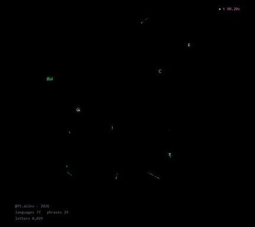
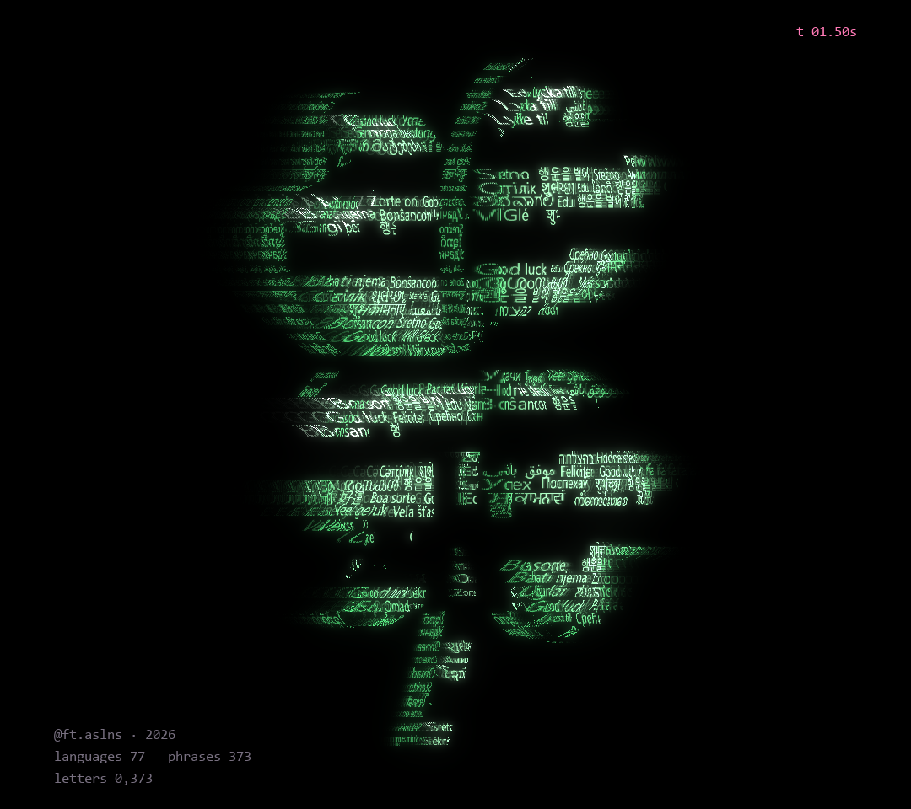
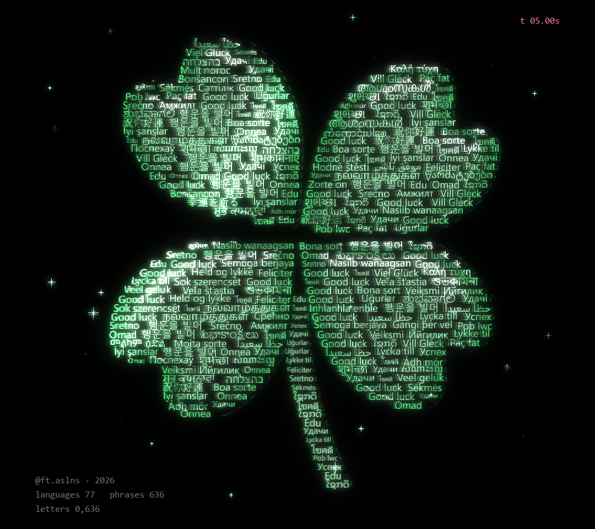
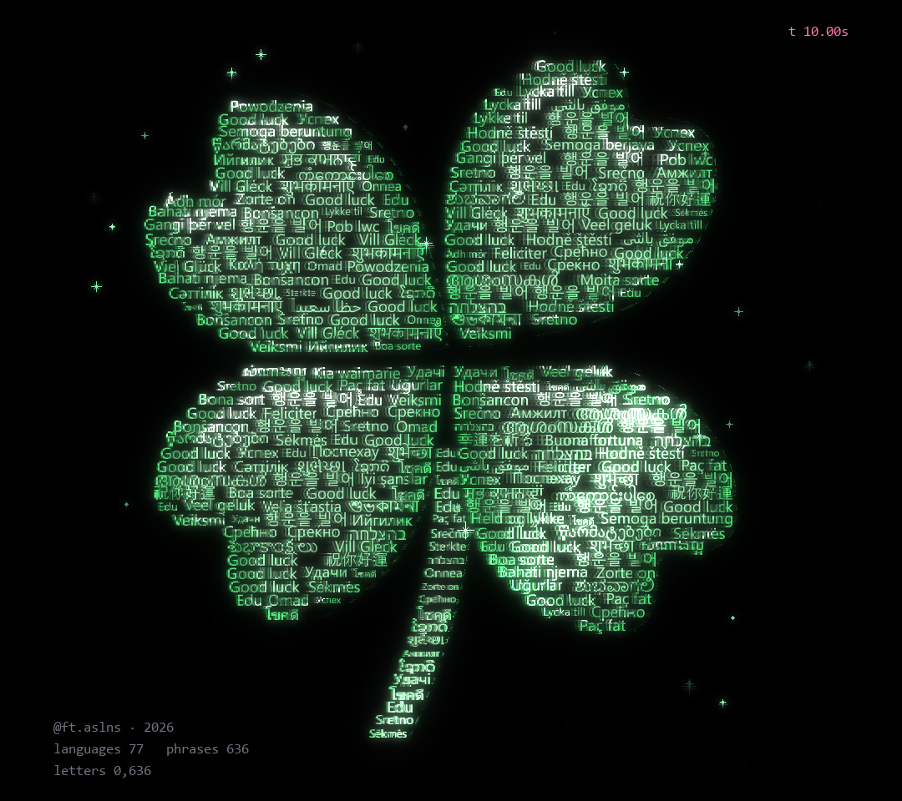

# GOOD LUCK

**[Play on your phone — no installation](https://amsoulness.github.io/aslns-ascii-art/?art=GOOD-LUCK)**

Four-Leaf Clover · ASCII Code Art · ASLNS, 2026



## Artist's Note

Last time I made a heart that says "I love you" in every language, and it gave me the idea for this four-leaf clover.
"Good luck" in 77 languages, written row by row, and the letters alone make the clover.
I hope good luck finds every one of you.

| typing | turning | front |
|---|---|---|
|  |  |  |

## Technology

Python · NumPy · OpenCV · pygame-ce

## Creative Process

1. Phrases: "Good luck" in 77 languages, each drawn once so every script is shaped correctly.
2. Shape: each leaf is one heart, four of them point out from the middle, and a curved stem runs down.
3. Rows: each row of every leaf is filled edge to edge with whole phrases, like justified text.
4. Depth: every leaf has flat sides, a bulging face and a raised rim; the stem is a thinner rod.
5. Glass and light: the clover turns to the right, pale green in the middle and deep green at the edge, with a band of light and small green stars.

## Technical Concepts

Justified text layout · distance transform for depth · rotation about the vertical axis with depth ordering
Green glass shading by edge thickness and reflection · light sweep and sparkles · trail and glow pass

## Source Code

The full Python source is free and included in this folder.

```
pip install -r requirements.txt
python good_luck.py
```

Space pause, R restart, S screenshot, Esc quit.
Rules for using this code:
I share this code for you. Study it, change it, and use what you learn to make your own ASCII art.
- Don't repost this code, or a big part of it, as your own.
- Don't post my artwork (videos or images) as your own.
- Don't sell it, or use it commercially without my permission.
- Don't use it to train AI models.

A credit to @ft.aslns is always appreciated. If you see my code or artwork posted as someone else's, please report it and let me know on Instagram [@ft.aslns](https://instagram.com/ft.aslns).

Full terms: [LICENSE.txt](LICENSE.txt)

---

Artist: ASLNS · Instagram [@ft.aslns](https://instagram.com/ft.aslns)
© 2026 ASLNS. All rights reserved. Images and video in this repository may not be reused without permission.

## Setup and controls

Tested on Windows with Python 3.12. From this artwork folder:

```sh
python -m pip install -r requirements.txt
python good_luck.py
```

Click the artwork window to use **Space** to pause/resume, **R** to restart,
**S** to save a PNG beside `good_luck.py`, and **Esc** to close.
The animation repeats automatically and the window scales to the available display.

Keep the complete artwork folder together when moving it. The bundled sprites/ directory is required. Playwright and Chromium are only needed for the optional tools/make_phrases.py sprite generator, not for running the artwork.

## Preview capture

The three screenshots and `images/preview.gif` were regenerated by running this artwork's
window renderer on 26 November 2026. Screenshots retain the full 1080 × 960 canvas,
including attribution and status text. The looping GIF is 432 × 384 at 5 fps;
it samples the complete animation rather than recording real-time desktop performance.
The capture runner evaluates 10 animation timestamps per second with an offscreen display.

From the repository root, install `requirements-preview.txt`, then run:

```sh
python tools/capture_previews.py GOOD-LUCK
```

See [capture details](../PREVIEWS.md) and [capture timestamps](../PREVIEW_CAPTURE.json).
