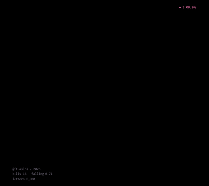
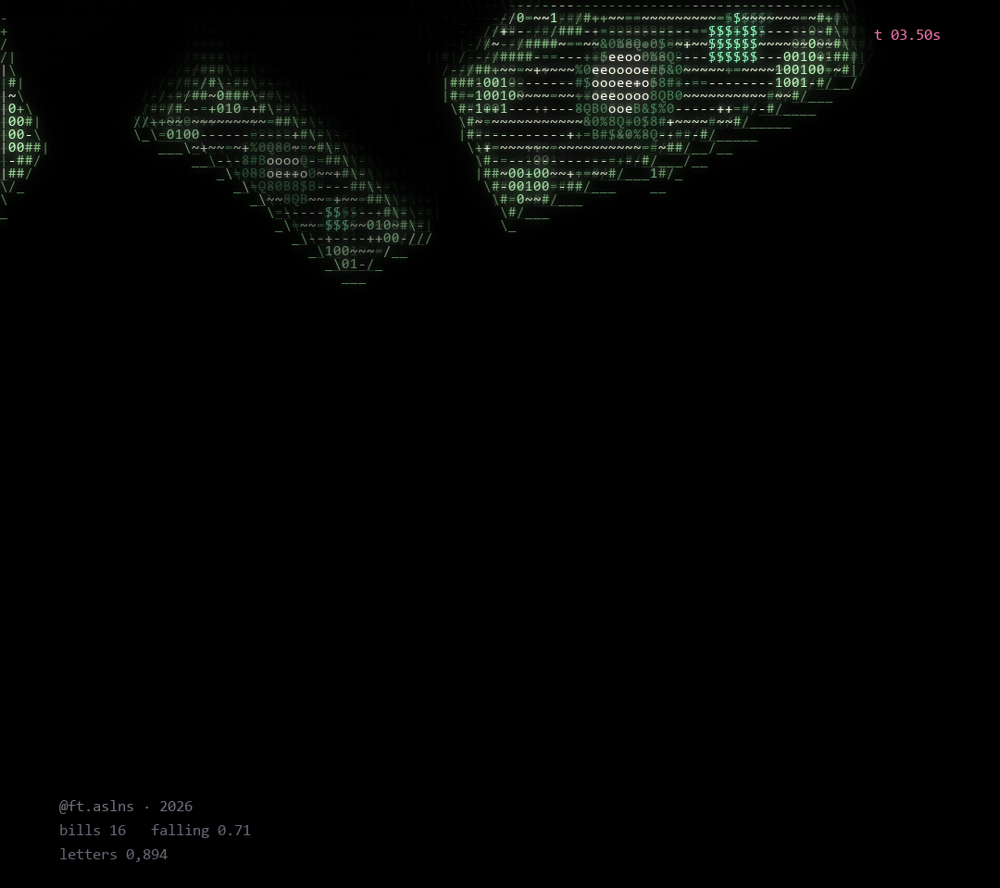
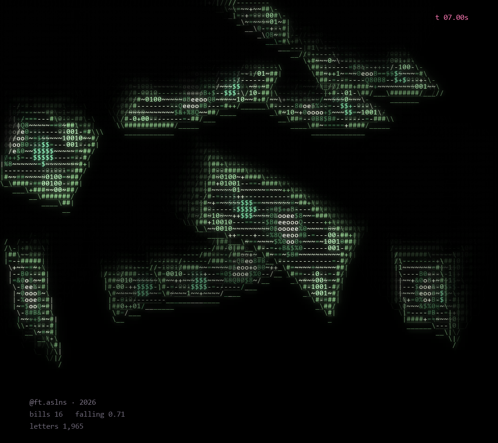
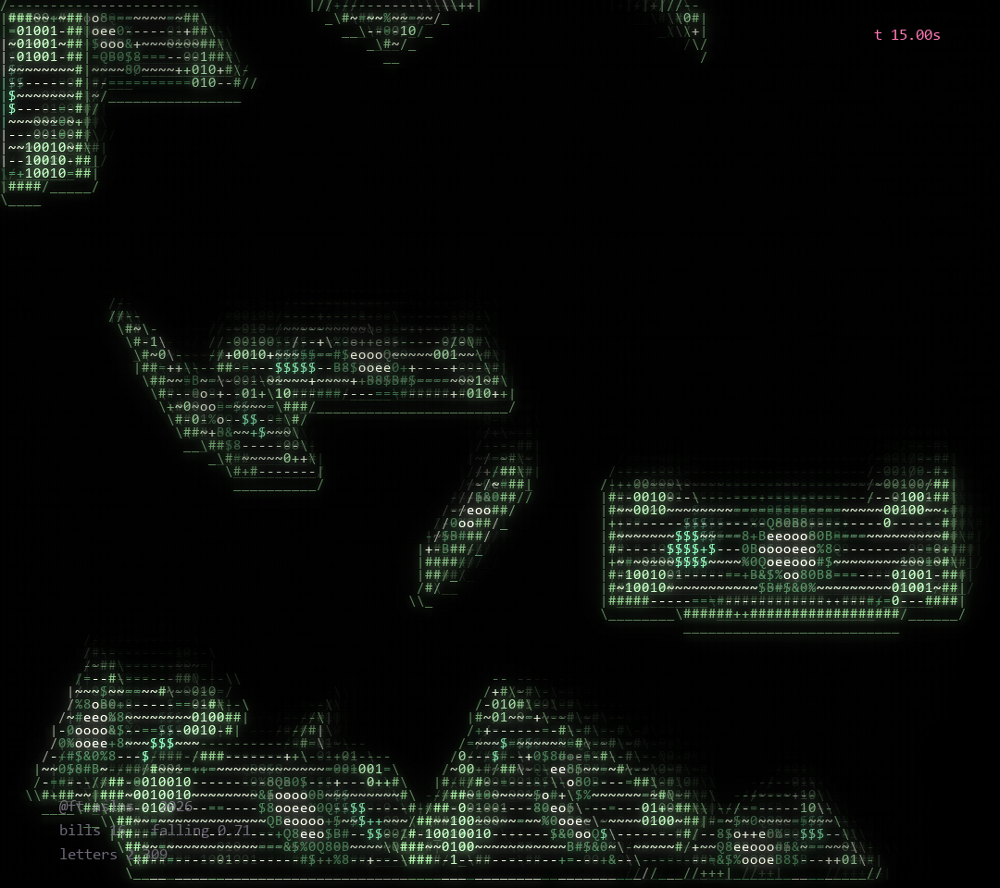

# MONEY RAIN

**[Play on your phone — no installation](https://amsoulness.github.io/aslns-ascii-art/?art=MONEY-RAIN)**

Money Rain · ASCII Code Art by ASLNS, 2026



## Artist's Note

Hundred-dollar notes fall one after another, each at its own depth and speed.
They sway, tumble and turn on the way down, and every note is drawn only with letters, numbers and symbols.

| first notes | rain | full rain |
|---|---|---|
|  |  |  |

## Technology

Python · NumPy · pygame-ce

## Creative Process

1. Form: one hundred-dollar note is a grid of points, and each point knows what is printed on it (border, frame lines, portrait, seal, the 100 in each corner).
2. Falling: sixteen notes start one after another, each with its own place, depth, speed and wobble.
3. Motion: a note sways from side to side, tumbles and turns, and a soft S-curve rolls along the paper.
4. ASCII Rendering: the screen becomes a grid of letter cells. Edges turn into | / \ - _ and the inside gets letters for what is printed there.
5. Depth: notes further away are drawn dimmer.

## Technical Concepts

3D rotation and perspective projection · nearest point per cell with depth ordering · outline detection
Per-note motion (sway, tumble, paper curl) · character pools from dark to bright · glow pass

## Source Code

The full Python source is free and included in this folder.

```
pip install -r requirements.txt
python money_rain.py
```

Space pause, R restart, S screenshot, Esc quit.
Rules for using this code:
I share this code for you. Study it, change it, and use what you learn to make your own ASCII art.
- Don't repost this code, or a big part of it, as your own.
- Don't post my artwork (videos or images) as your own.
- Don't sell it, or use it commercially without my permission.
- Don't use it to train AI models.

A credit to @ft.aslns is always appreciated. If you see my code or artwork posted as someone else's, please report it and let me know on Instagram [@ft.aslns](https://instagram.com/ft.aslns).

Full terms: [LICENSE.txt](LICENSE.txt)

---

Artist: ASLNS · Instagram [@ft.aslns](https://instagram.com/ft.aslns)
© 2026 ASLNS. All rights reserved. Images and video in this repository may not be reused without permission.

## Setup and controls

Tested on Windows with Python 3.12. From this artwork folder:

```sh
python -m pip install -r requirements.txt
python money_rain.py
```

Click the artwork window to use **Space** to pause/resume, **R** to restart,
**S** to save a PNG beside `money_rain.py`, and **Esc** to close.
The animation repeats automatically and the window scales to the available display.

Keep the complete artwork folder together when moving it.

## Preview capture

The three screenshots and `images/preview.gif` were regenerated by running this artwork's
window renderer on 26 November 2026. Screenshots retain the full 1080 × 960 canvas,
including attribution and status text. The looping GIF is 432 × 384 at 5 fps;
it samples the complete animation rather than recording real-time desktop performance.
The capture runner evaluates 10 animation timestamps per second with an offscreen display.

From the repository root, install `requirements-preview.txt`, then run:

```sh
python tools/capture_previews.py MONEY-RAIN
```

See [capture details](../PREVIEWS.md) and [capture timestamps](../PREVIEW_CAPTURE.json).
