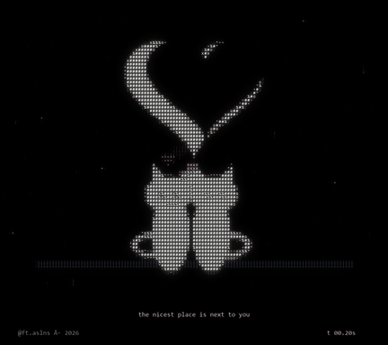
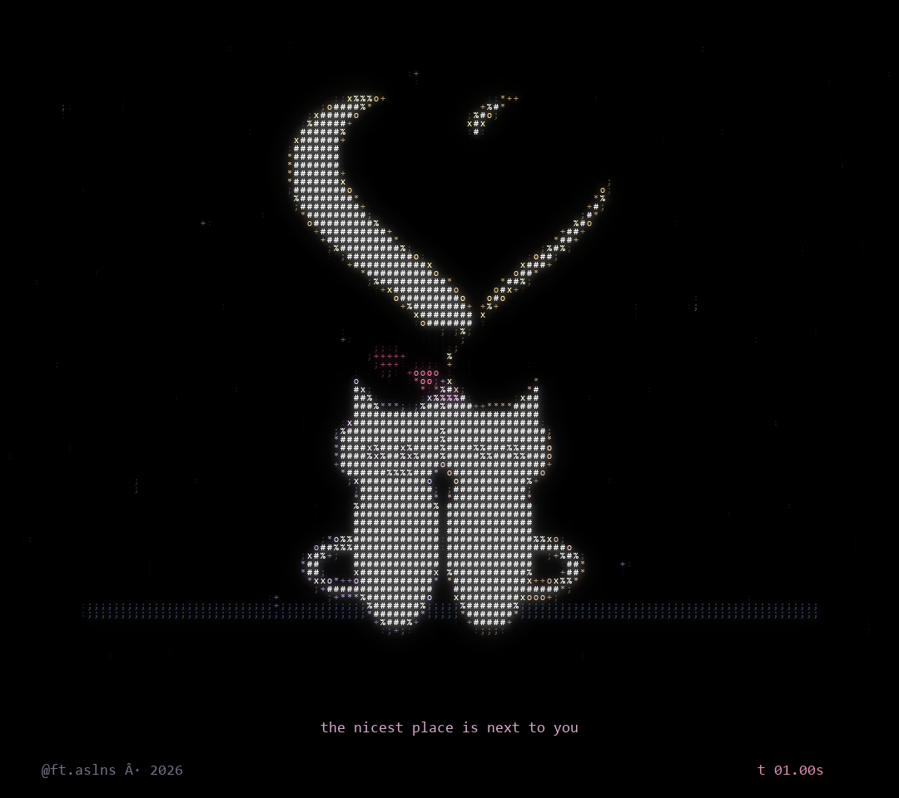
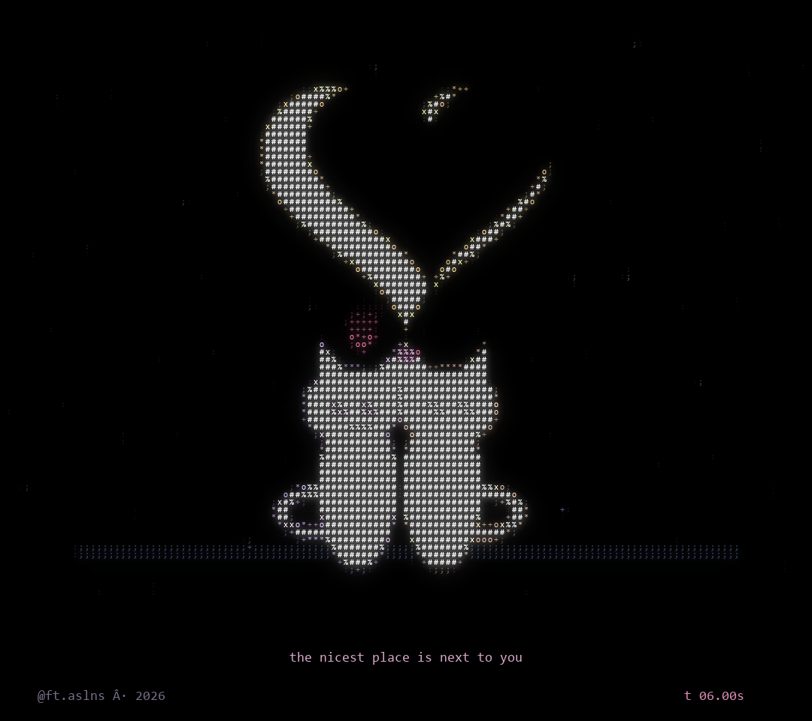
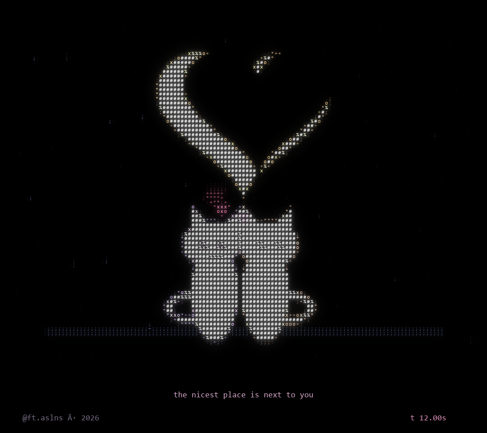

# MOONLIGHT CATS

Moonlight Cats · ASCII Code Art · ASLNS, 2026

**[Play on your phone](https://amsoulness.github.io/aslns-ascii-art/?art=MOONLIGHT-CATS)**



Two cats sit together beneath a glowing heart-shaped crescent moon.

| beginning | forming | finished |
|---|---|---|
|  |  |  |

## Run on a computer

```sh
python -m pip install -r requirements.txt
python moonlight_cats.py
```

Click the artwork window. Space pauses, R restarts, S saves a screenshot beside
the script, and Esc closes. The window scales to your display.

## How it works

The scene is drawn from curves, ellipses, polygons, and twinkling points.
It is sampled into a 135 × 80 grid. Brightness selects an ASCII glyph,
the original color tints it, and a soft glow surrounds the characters.
The 18-second animation loops automatically.

Python · NumPy · pygame-ce. No external image assets are required.

## Previews and mobile playback

Three full-canvas screenshots and a looping GIF were captured from the actual
Python window renderer on 26 November 2026. The mobile gallery plays an H.264
export of this render. Name Heart runs live in a browser canvas: each visitor can type a name, and
the repeated name itself forms the heart. Its archived preview uses "Your name".
See [PREVIEWS.md](../PREVIEWS.md) for regeneration commands.

## License

ASLNS · [@ft.aslns](https://instagram.com/ft.aslns) · 2026.
See [LICENSE.txt](LICENSE.txt) for the personal-use permissions and restrictions.

Glow: the same two additive bloom passes as Rose: a close halo at 0.75
strength (radius 5) and a wide halo at 0.45 strength (radius 22).
