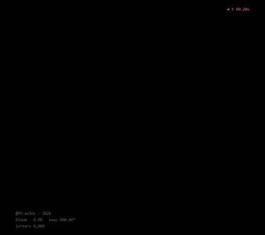
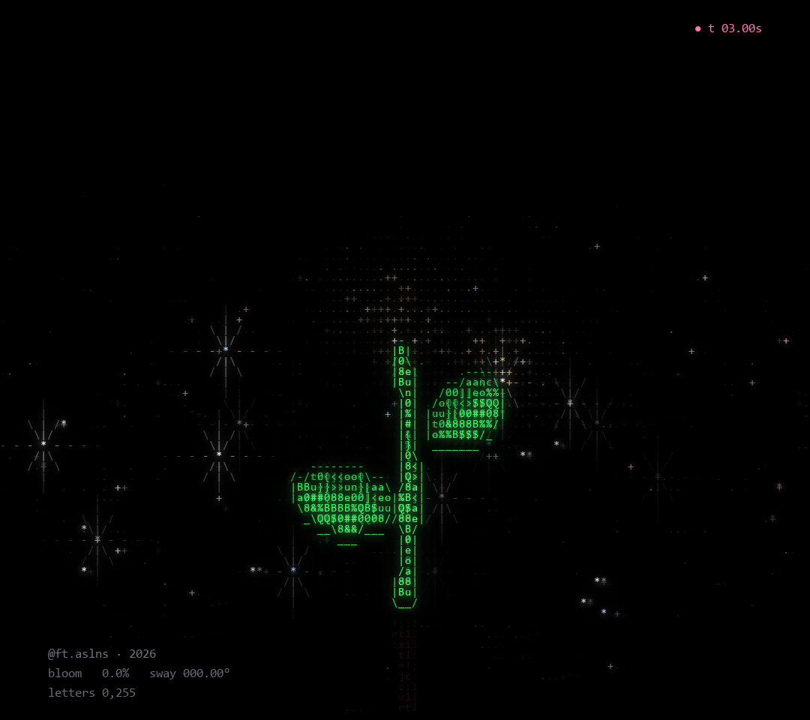
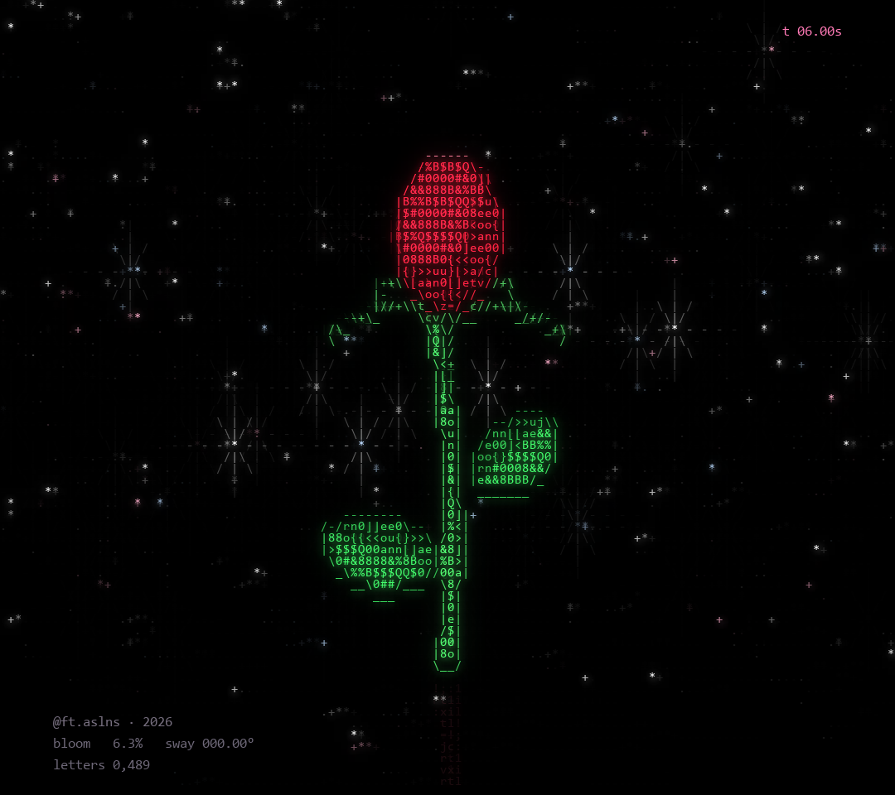
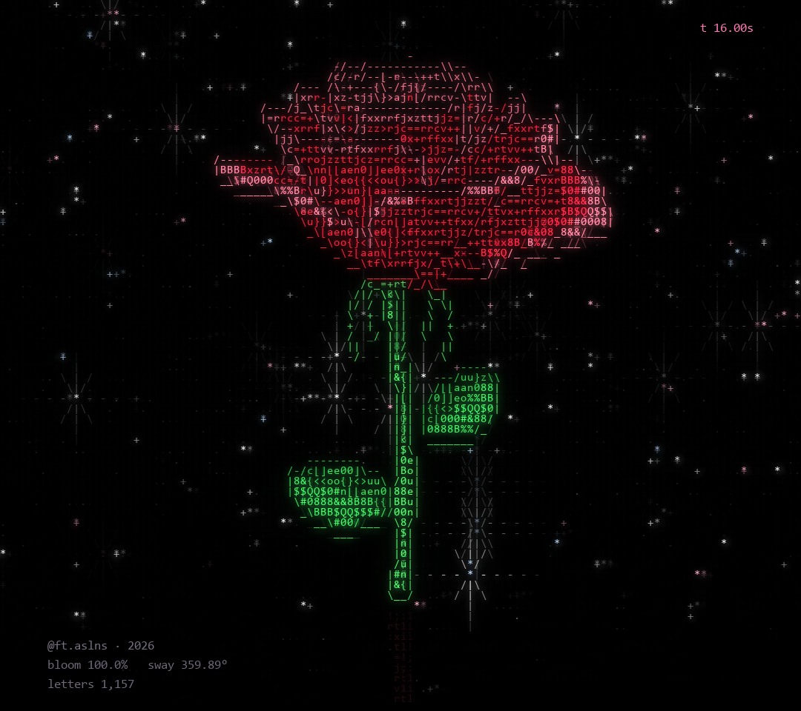

# IN BLOOM

**[Play on your phone — no installation](https://amsoulness.github.io/aslns-ascii-art/?art=ROSE)**

Rose · ASCII Code Art by ASLNS, 2026



## Artist's Note

A single line of light grows into a stem, a bud forms, and slowly, petal by petal, it opens.
Drawn only with letters, numbers and symbols.

| growing | bud | in bloom |
|---|---|---|
|  |  |  |

## Technology

Python · NumPy · pygame-ce

## Creative Process

1. Form: the stem, leaves, sepals and a closed bud are built in 3D.
2. Growth: a travelling point of light draws the stem up, then the bud fills in.
3. Bloom: one spiral surface loosens from the bud into a full rose, outer petals first.
4. Motion: a soft sway, petals trailing behind it, dewdrops that fall and splash.
5. ASCII Rendering: the scene becomes a grid of characters, shaded by brightness.

## Technical Concepts

3D geometry and rotation · parametric spiral surfaces · perspective projection with depth ordering
Diffuse and specular lighting · particle motion with gravity · outline detection · character-based shading

## Source Code

The full Python source is free and included in this folder.

```sh
pip install -r requirements.txt
python rose.py
```
Space pause, R restart, S screenshot, Esc quit.
Rules for using this code:
I share this code for you. Study it, change it, and use what you learn to make your own ASCII art.
- Don't repost this code, or a big part of it, as your own.
- Don't post my artwork (videos or images) as your own.
- Don't sell it, or use it commercially without my permission.
- Don't use it to train AI models.

A credit to @ft.aslns is always appreciated. If you see my code or artwork posted as someone else's, please report it and let me know on Instagram [@ft.aslns](https://instagram.com/ft.aslns).

Full terms: [LICENSE.txt](LICENSE.txt)

If you'd like to support my work, the same code is also on [Payhip](https://payhip.com/b/7WP5A).

---

Artist: ASLNS · Instagram [@ft.aslns](https://instagram.com/ft.aslns)
© 2026 ASLNS. All rights reserved. Images and video in this repository may not be reused without permission.

## Setup and controls

Tested on Windows with Python 3.12. From this artwork folder:

```sh
python -m pip install -r requirements.txt
python rose.py
```

Click the artwork window to use **Space** to pause/resume, **R** to restart,
**S** to save a PNG beside `rose.py`, and **Esc** to close.
The animation repeats automatically and the window scales to the available display.

Keep the complete artwork folder together when moving it.

## Preview capture

The three screenshots and `images/preview.gif` were regenerated by running this artwork's
window renderer on 26 November 2026. Screenshots retain the full 1080 × 960 canvas,
including attribution and status text. The looping GIF is 432 × 384 at 5 fps;
it samples the complete animation rather than recording real-time desktop performance.
The capture runner evaluates 10 animation timestamps per second with an offscreen display.

From the repository root, install `requirements-preview.txt`, then run:

```sh
python tools/capture_previews.py ROSE
```

See [capture details](../PREVIEWS.md) and [capture timestamps](../PREVIEW_CAPTURE.json).
