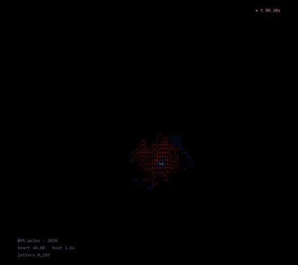
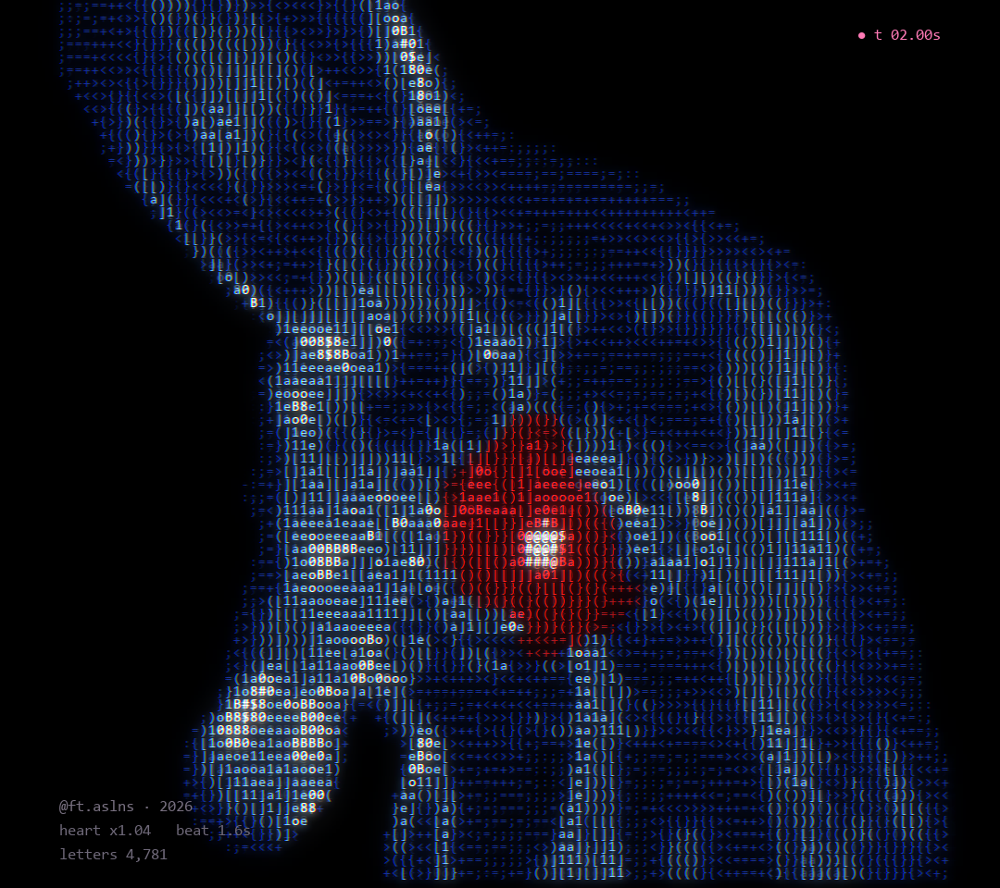
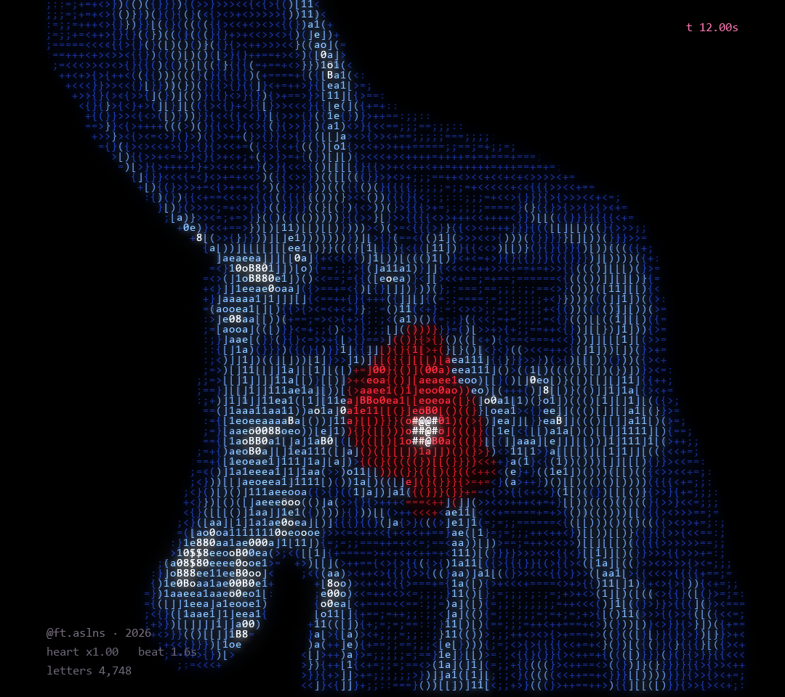

# SKIPPED A BEAT

**[Play on your phone — no installation](https://amsoulness.github.io/aslns-ascii-art/?art=SKIPPED-A-BEAT)**

Startled Heart · ASCII Code Art by ASLNS, 2026



## Artist's Note

Horror game streamer clips keep showing up in my Reels, and people always drop this picture in the comments.
The meme was so funny and relatable that I made my own version, drawn only in letters and numbers.
Every 1.6 seconds the whole body flinches, the heart swells out of the chest and a shock wave runs down the veins.

| arriving | flinch | heart |
|---|---|---|
|  |  |  |

## About the Picture

The x-ray body picture is not mine, so this piece is not for sale and the picture is not included.
The finished letters of all 480 frames are in skipped_a_beat_frames.npz, and the full code to play them is shared here.
All credit for the picture goes to its creator.

## Technology

Python · NumPy · pygame-ce (the frames were made with OpenCV)

## Creative Process

1. Layers: the picture is split into the blue body and the red heart.
2. Flinch: every 1.6 seconds the body jumps by 6 percent and shivers back, with a smaller second beat after it.
3. Heart: the area around the heart is pushed outwards, so it swells out of the chest, and a white spark flares up.
4. Shock wave: a ring of light runs out from the heart along the veins.
5. ASCII Rendering: each frame becomes a grid of 120 x 68 letters; brightness picks the letter and the colour marks body, heart and spark.

## Technical Concepts

Image warping with remap · damped spring curve for the flinch · radial bulge around a point
Letter grid by brightness · colour split on impact · trail and glow pass

## Source Code

The full Python source is included in this folder.

```
pip install -r requirements.txt
python skipped_a_beat.py
```

Space pause, R restart, S screenshot, Esc quit.
Rules for using this code:
I share this code for you. Study it, change it, and use what you learn to make your own ASCII art.
- Don't repost this code, or a big part of it, as your own.
- Don't post my artwork (videos or images) as your own.
- Don't sell it, or use it commercially without my permission.
- Don't use it to train AI models.

A credit to @ft.aslns is always appreciated. If you see my code or artwork posted as someone else's, please report it and let me know on Instagram [@ft.aslns](https://instagram.com/ft.aslns).

Full terms: [LICENSE.txt](LICENSE.txt)

---

Artist: ASLNS · Instagram [@ft.aslns](https://instagram.com/ft.aslns)
Code © 2026 ASLNS. The x-ray body picture belongs to its creator.

## Setup and controls

Tested on Windows with Python 3.12. From this artwork folder:

```sh
python -m pip install -r requirements.txt
python skipped_a_beat.py
```

Click the artwork window to use **Space** to pause/resume, **R** to restart,
**S** to save a PNG beside `skipped_a_beat.py`, and **Esc** to close.
The animation repeats automatically and the window scales to the available display.

Keep the complete artwork folder together when moving it. The bundled *_frames.npz file contains precomputed character animation; the supplied script plays it. The original source photo is not included and belongs to its creator.

## Preview capture

The three screenshots and `images/preview.gif` were regenerated by running this artwork's
window renderer on 26 November 2026. Screenshots retain the full 1080 × 960 canvas,
including attribution and status text. The looping GIF is 432 × 384 at 5 fps;
it samples the complete animation rather than recording real-time desktop performance.
The capture runner evaluates 10 animation timestamps per second with an offscreen display.

From the repository root, install `requirements-preview.txt`, then run:

```sh
python tools/capture_previews.py SKIPPED-A-BEAT
```

See [capture details](../PREVIEWS.md) and [capture timestamps](../PREVIEW_CAPTURE.json).
