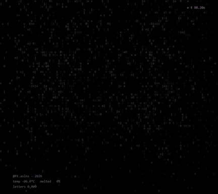
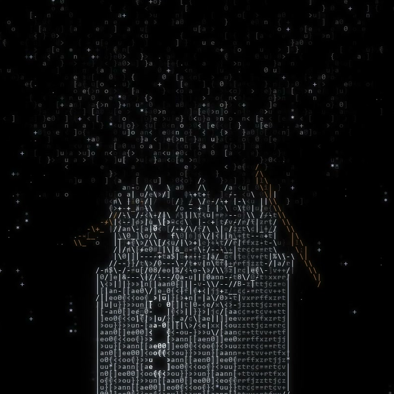
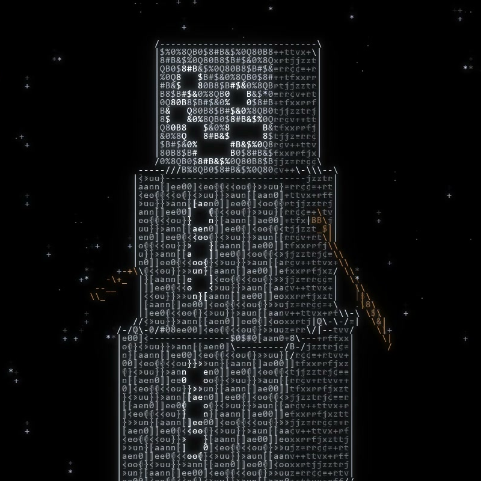
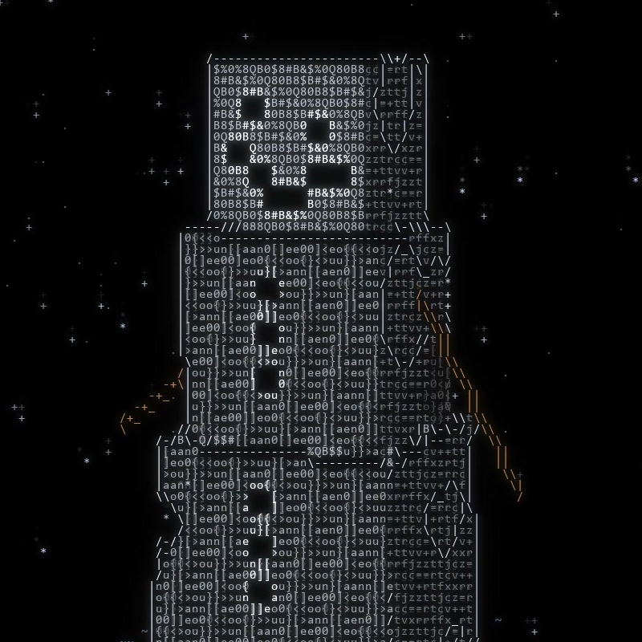

# DON'T MELT

Snowman · ASCII Code Art · ASLNS, 2026



## Artist's Note

It's winter, and listening to the song Snowman made me think of Wilson, my name for the Minecraft snowman.
Then I wondered: what if Wilson melted?
A little block snowman made of letters stands in the falling snow and melts piece by piece, still smiling.

| gathering | standing | melting |
|---|---|---|
|  |  |  |

## Technology

Python · NumPy · pygame-ce

## Creative Process

1. Form: three blocks of voxels stacked from large to small, with eyes, smile and buttons left out as black squares.
2. Build-in: the letters gather from the bottom up, a few flying in from the dark.
3. Snow: hundreds of flakes drift down around him, nearer ones brighter.
4. Melting: chunks come loose one by one, fall with gravity, bounce twice, skid and melt into a puddle.
5. ASCII Rendering: points become letters, denser where the surface is brighter, with outlines along the edges.

## Technical Concepts

Voxel point clouds · fixed perspective camera with depth ordering · projectile motion with bounces and friction
Outline detection · character-based shading · trail and glow pass

## Source Code

The full Python source is free and included in this folder.

```
pip install -r requirements.txt
python snowman.py
```

Space pause, R restart, S screenshot, Esc quit.
Rules for using this code:
I share this code for you. Study it, change it, and use what you learn to make your own ASCII art.
- Don't repost this code, or a big part of it, as your own.
- Don't post my artwork (videos or images) as your own.
- Don't sell it, or use it commercially without my permission.
- Don't use it to train AI models.

A credit to @ft.aslns is always appreciated. If you see my code or artwork posted as someone else's, please report it and let me know on Instagram [@ft.aslns](https://instagram.com/ft.aslns).

Full terms: [LICENSE.txt](LICENSE.txt)

---

Artist: ASLNS · Instagram [@ft.aslns](https://instagram.com/ft.aslns)
© 2026 ASLNS. All rights reserved. Images and video in this repository may not be reused without permission.
